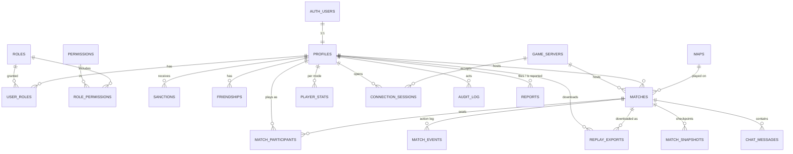

# CatanDabuVerse — Database & Identity Design (Draft v0.3)

Target: **Supabase** (Postgres 17 + Supabase Auth + RLS). The schema itself lives in [`supabase/migrations/`](../../supabase/migrations/) (source of truth); this document explains *why*.

---

## 1. Where we are today

| Concern | Current implementation | Problem |
|---|---|---|
| Identity | Free-text `username` typed in the lobby; per-seat random `secret` stored in `localStorage` for reconnect | No accounts; names collide across rooms; no persistent history per person |
| Game state | `rooms` dict in `server.py` memory | Lost on restart/crash; can't run >1 server instance |
| Persistence | SQLite `match_history(room_code, winner TEXT, victory_points, game_mode)` | Winner is a name string, losers not recorded, no settings/map/duration. `save_match` is called from 4 places (`server.py:811, 1526, 1929, 1981`) so a game can be written more than once |
| Chat / log | `room['gameLog']` strings (`"[CHAT] name: text"`) | Not queryable, not moderatable |
| Admin / monitoring | none (`print` debug) | — |

## 2. Design principles

1. **Supabase Auth owns credentials.** We never store passwords. `auth.users` is the source of truth; our `public.profiles` is a 1:1 extension.
2. **The game server stays authoritative and in-memory for the hot path.** Postgres is *not* hit on every dice roll. The server writes: lifecycle events (create/start/end), an append-only action log (batched), periodic snapshots, and the final result.
3. **The server talks to Postgres with the `service_role` key** (bypasses RLS). Browsers use the `anon` key + the user's JWT and can only **read** what RLS allows (own profile, public match history, leaderboards). All game writes go through the server.
4. **IAM = RBAC in our own tables**, injected into the JWT through a Supabase *Custom Access Token Hook*, enforced by RLS on the DB side and by the Python server on the socket side.
5. **Everything sensitive leaves an audit trail** (`audit_log`), which is also the backbone of the monitoring site.

## 3. Identity, login & SSO

| Login method | Supabase feature | Notes |
|---|---|---|
| Email + password, magic link | Built-in | Backup login (decided). Email confirmation on, password reset via email |
| Google, Discord (SSO) | OAuth providers | Free tier. No SAML/enterprise SSO (decided) |
| Guest / "play now" | Anonymous sign-ins | **Kept** (decided). Accounts are optional. A guest can later **link** Google/Discord/email and keep their history (same `user_id`) |

**Socket auth flow (replaces username + seat secret):**

```
Browser ──(supabase-js login)──► Supabase Auth ──► JWT (sub=user_id, app_roles=[...])
Browser ──socket.io connect, auth:{token: JWT}──► server.py
server.py: verify JWT via Supabase JWKS → sid ↔ user_id ↔ seat
```
Reconnect becomes "same `user_id` → same seat" — no more `catan_token` in `localStorage`, and seat hijacking by name is impossible by construction.

## 4. IAM model

```
user ──< user_roles >── role ──< role_permissions >── permission
```

Seed roles (global scope):

| Role | Intended for | Key permissions |
|---|---|---|
| `player` | every account (auto-granted) | `match.create`, `match.join`, `chat.send`, `replay.export` |
| `guest` | anonymous users | same as `player` today; kept separate so guest limits can be added later |
| `moderator` | community mods | `chat.delete`, `user.mute`, `report.resolve`, `match.view_any` |
| `admin` | operators | all of the above + `user.ban`, `role.assign`, `monitor.view`, `match.terminate`, `map.manage` |
| `superadmin` | owner | `*` (incl. `role.manage`, `audit.view`) |

- `user_roles.expires_at` allows time-boxed grants (e.g. trial moderator).
- `sanctions` (ban / mute) are separate from roles: they *remove* ability and have reason + expiry + issuer.
- The access-token hook adds `app_roles` and `app_permissions` to the JWT; SQL helper `public.authorize('perm')` reads them for RLS. Role changes take effect at the next token refresh (≤ 1 h by default); bans are additionally checked live by the server.

## 5. Entity-relationship overview



## 6. Tables by domain

### 6.1 Identity
| Table | Purpose | Key columns |
|---|---|---|
| `profiles` | Public player identity | `id` (=auth.users.id), `username` (unique, citext), `display_name`, `avatar_url`, `country`, `is_guest`, `last_seen_at` |
| `user_settings` | Per-user preferences | `user_id`, `preferred_color`, `sound_enabled`, `reduced_motion`, `locale` |

A trigger on `auth.users` insert creates the `profiles` row and grants `player` (or `guest` if anonymous). A second trigger fires when a guest links Google/Discord/email (`is_anonymous` → false): it clears `is_guest` and swaps `guest` → `player`, keeping the same `user_id`. Users can only update `username`, `display_name`, `avatar_url`, `country` (column-level grant).

### 6.2 IAM
`roles`, `permissions`, `role_permissions`, `user_roles`, `sanctions`.

### 6.3 Game catalog
| Table | Purpose |
|---|---|
| `maps` | Mirror of `map_layouts.py` registry: `id` (`standard`, `four_islands`…), `modes[]` (a map can serve several modes), `name`, `description`, `default_vp`, `min/max_players`, `preview_url`, `is_active`. Seeded from code; lets admins disable a map without a deploy |

### 6.4 Matches (replaces `match_history`)
| Table | Purpose | Notes |
|---|---|---|
| `matches` | One row per room/game | `room_code` (not unique over time — only among *live* matches), `mode`, `map_id`, `settings jsonb` (vp limit, timeout, hideBankCards, balancedDice), `status` (`lobby → setup → playing → finished / abandoned / terminated`), `host_id`, `server_id`, `created_at/started_at/ended_at`, `winner_participant_id`, `end_reason`, `replay_expires_at`, `replay_purged_at` |
| `match_participants` | One row per **seat** (human or bot) | `user_id` NULL for bots, `bot_type` (`bot_easy`, `bot_mcts`…), `display_name` (snapshot at the time), `seat_index`, `turn_order`, `color`, `final_vp`, `placement`, `is_winner`, `left_at`, `stats jsonb` |
| `match_events` | One row per state-changing action: the replay frames | `(match_id, seq)` PK, `turn_no`, `actor_seat`, `type` (`rollDice`, `buildRoad`…), `payload` (client input), `patch` (JSON Patch of the state change), `log_lines`. Written in batches (e.g. every turn end) |
| `match_snapshots` | Full state keyframes | `seq 0` = initial board, then every `replay_keyframe_every` events (default 50) for fast seeking. Also used for crash recovery of live games |
| `chat_messages` | Lobby/in-game chat split out of `gameLog` | `deleted_by`, `deleted_at` for moderation |

`stats jsonb` per participant (filled at game end) — e.g. `{"resources_gained":…, "roads":12, "longest_road":true, "largest_army":false, "knights_played":3, "dev_cards_bought":5, "trades":7}` — keeps the schema stable while the stats list grows.

### 6.5 Replays (rewatch + export)

**Recording.** After every action the server already builds the new state to broadcast. The recorder also builds one *replay state*: the full `room` with **all hands revealed** (it's only viewable after the game ends) and secrets stripped (deck order, seat tokens). It stores a JSON Patch from the previous replay state. A keyframe is written at the start and every 50 events.

**Watching (in the app).** `/replay/:matchId` loads the nearest keyframe and applies patches forward. The result goes straight into the existing `BoardCanvas` / `PlayerDashboard`, so **no rules engine is needed in the browser**. Controls: play/pause, speed, step, jump to turn, and "view as seat N" (hides other hands).

**Who can watch.** Participants of a *finished* match (guests too), plus moderators/admins (`match.view_any`), **plus anyone holding a share link**. Live games can never be replayed (no spying on hands).

**Share links.** A participant clicks "Share", which inserts into `replay_shares` and gets a 16-char random token, e.g. `/r/Xk3_9fQ…`. Opening the link calls the RPC `get_shared_replay(token)`, which works without an account (`anon`), counts the view and returns the replay. The link stops working when the creator revokes it or when the replay is purged (the page then says "expired, ask the player for the file"). All three entry points (in-app viewer, share link, export) use one SQL function, `build_replay(match_id)`, so they return the same format.

**Retention.** At finish, `replay_expires_at = ended_at + replay_retention_days` (from `app_config`, default **7**, editable on the admin site). A daily `pg_cron` job, `purge_expired_replays()`, deletes events + keyframes and sets `replay_purged_at`. The match row, participants, stats and chat **are kept**, so match history still shows the game and only the "Watch" button disappears.

**Export.** A "Download replay" button (until expiry) calls `GET /api/replays/{match_id}/export` on `server.py`. The server checks the JWT + participation, then streams a `.catanreplay` file (gzipped JSON):
```json
{ "format": "catanreplay", "version": 1,
  "match": { "id", "mode", "map_id", "settings", "started_at", "ended_at" },
  "participants": [ { "seat", "display_name", "color", "bot_type", "final_vp", "is_winner" } ],
  "keyframes": [ { "seq", "state" } ],
  "events": [ { "seq", "turn_no", "actor_seat", "type", "patch", "log_lines" } ] }
```
Each download is logged in `replay_exports` (for the admin site). The same replay page has **"Open replay file"**, which plays a downloaded file locally with no server or account, so a game a player loved stays watchable forever after the server copy is purged.

**Size estimate.** A typical 4-player game is ~300–600 actions with patches of ~100–500 B each, so roughly 100–300 KB raw and ~30–80 KB gzipped. Short retention keeps the database small.

### 6.6 Multiple game servers

A live room's state is in one process's memory, so **each live room is owned by exactly one server** (`matches.server_id`). The servers are stateless towards each other. Postgres is the directory:

```
Create room:  client ─► pick_game_server()  ─► least-loaded active server URL ─► connect there, createRoom
Join room:    client ─► find_room('ABCD')   ─► owner's public_url             ─► connect there, joinRoom
```

- **Room codes stay globally unique** through the partial unique index on live `matches.room_code`. The server inserts the `matches` row *before* accepting the room, so two servers can never take the same code.
- **Health:** each server upserts `game_servers` (heartbeat every 15 s, `active_rooms`, `connected_sockets`). `pick_game_server()` only returns servers that are `active`, sent a heartbeat in the last 45 s and are under `max_rooms`.
- **Deploys (no dropped games):** set the old server to `draining`, so it takes no new rooms but finishes its current games. Start the new version, and stop the old one when its `active_rooms` = 0.
- **Crash failover:** every healthy server runs `claim_orphaned_matches(self)` every ~30 s. A server silent for 60 s is marked `dead`. Its lobbies are closed (`abandoned`), and its in-progress games are claimed by survivors (`FOR UPDATE SKIP LOCKED`, so no double claim) and rebuilt from the latest keyframe + patches. Clients see a disconnect, call `find_room` again and reconnect to the new owner. Events are flushed at least every turn end, so a crash loses at most the current turn, which restarts from its beginning.
- **Hosting:** Supabase hosts only the DB/Auth. The game servers run elsewhere (Fly.io, Railway, a VPS…), each with its own public URL (`wss://gs-1.…`). No sticky load-balancer magic is needed, because the client is told exactly which URL to use.
- **Admin site:** server list with status/load, a "Drain" button, and counts of recovered games (`matches.recovered_count`).

### 6.7 Progression
| Table | Purpose |
|---|---|
| `player_stats` | Aggregates per `(user_id, mode)`: games, wins, total VP, longest-road/largest-army counts, win streak. Updated in the same transaction as match finalization |
| `friendships` | `(user_id, friend_id, status)`: optional phase 2 |
| *(later)* ranking | `rating` columns on `player_stats` + `rating_history` table: deferred (decided) |

### 6.8 Monitoring & operations (admin site)
| Table / view | Purpose |
|---|---|
| `game_servers` | Each `server.py` instance upserts a heartbeat every ~15 s: `hostname`, `version`, `started_at`, `last_heartbeat_at`, `active_rooms`, `connected_sockets`, `cpu/mem` |
| `connection_sessions` | Socket connect/disconnect per user: `ip_hash` (never raw IP), `user_agent`, `connected_at`, `disconnected_at`, `disconnect_reason` |
| `audit_log` | Who did what: logins (via auth hook), role grants, bans, match termination, chat deletions, admin edits. `actor_id`, `action`, `target_type`, `target_id`, `metadata jsonb`, `created_at`. Insert-only |
| `reports` | Player-filed reports (cheating, abuse) → moderation queue: `status`, `assigned_to`, `resolution` |
| `error_events` | Server exceptions (or send these to Sentry and skip the table) |
| `app_config` | Runtime settings edited from the admin site (`replay_retention_days`, `replay_keyframe_every`, …) |
| Views | `v_live_matches`, `v_server_health`, `v_daily_active_users`, `v_matches_per_day`, `v_mode_popularity`, `v_bot_winrates`, `v_replay_storage`. The `/admin` site reads these (RLS: `monitor.view`) |

Supabase Realtime on `game_servers` and `matches` gives the dashboard live updates without polling.

## 7. Who can read/write what (RLS summary)

| Table | Anyone (anon) | Authenticated user | Moderator | Admin | Server (service_role) |
|---|---|---|---|---|---|
| profiles | read public cols | update own | read all | update any | all |
| matches / participants | read finished | read own + finished | read all | all | all |
| match_events / snapshots | — | own finished matches (replays) | read | read | all |
| replay_exports | — | own | — | read | write |
| replay_shares | via `get_shared_replay(token)` only | create/revoke own (participants) | — | read/revoke any | all |
| routing RPCs (`find_room`, `pick_game_server`) | call | call | call | call | all (+ `claim_orphaned_matches`) |
| chat_messages | — | read own matches | read + soft-delete | all | all |
| player_stats | read | read | read | all | all |
| roles / permissions / user_roles | — | read own roles | read | assign (`role.assign`) | all |
| sanctions / reports | — | read own / create report | manage | manage | all |
| audit_log, game_servers, sessions | — | — | — | read (`monitor.view`) | write |
| app_config | — | — | — | via server API | all |

## 8. Code changes this implies

Tracked step by step in [`../roadmap.md`](../roadmap.md).

1. **Backend:** replace `sqlite3` with `asyncpg` (or `supabase-py`) via `DATABASE_URL`; add a `db/` module (`repo_matches.py`, etc.); verify JWT in the `connect` handler; key seats by `user_id` instead of `username`; one idempotent `finalize_match()` replacing the four `save_match` calls; heartbeat + `claim_orphaned_matches` loop; restore-room-from-keyframe; draining mode; **replay recorder** hooked into `broadcast_game_state` (diff with `jsonpatch`); `GET /api/replays/{id}/export` (gzip of `build_replay`).
2. **Frontend:** add `@supabase/supabase-js`; login screen (Google, Discord, "Play as guest"); pass `session.access_token` in `io(url, { auth })`; profile page, match history, **replay viewer** (`/replay/:id`, `/r/:token` share links, open-from-file); lobby calls `pick_game_server` / `find_room` before opening the socket.
3. **Admin site:** `/admin` route in the same React app (lazy-loaded chunk), gated by `monitor.view`: live matches, server health, DAU/matches charts, reports queue, user lookup (roles/sanctions), audit log, replay storage + retention setting.
4. **Migration:** the old SQLite `match_history` has winner names only — import as `matches` + a single winner participant with `user_id = NULL`, or just archive it.

## 9. Decisions (2026-10-09)

| Topic | Decision |
|---|---|
| Guests | Keep anonymous play; accounts optional |
| Sign-in | Google + Discord, with email/password (+ magic link) as backup; no SAML |
| Ranking | Later; plain stats now |
| Replays | Kept server-side for a few days (default 7, configurable), rewatchable in-app, **shareable by link** (no account needed), exportable as `.catanreplay` and playable from file forever |
| Scaling | Multiple game servers: room ownership + routing through Postgres, draining deploys, crash failover |
| Monitoring | `/admin` route in the main app |

No open design questions remain. The next step is implementation (§8).
